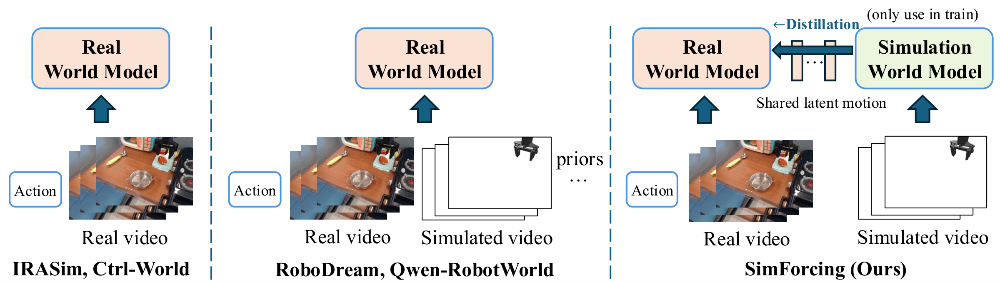

# Daily AI Robotics Briefing — October 6, 2026

## Papers

**SimForcing: Distilling Simulation Motion Priors into Real-Domain Robot World Models**

An action-conditioned robot world model that distills motion priors from a simulation teacher via latent-motion distillation — aligning temporal changes in latent space to sidestep the sim/real appearance gap. It tops PSNR/SSIM/LPIPS/FVD on Bridge without external embodied pretraining, and initializing a VLA from its experts lifts LIBERO success from 82.6% to 89.2%.

[arXiv](https://arxiv.org/abs/2610.06598) · [Project page](https://wang-xiaodong1899.github.io/SimForcing/) · [Code](https://github.com/Wang-Xiaodong1899/SimForcing)

**SUAVE: Unified Video-Action Models via Masked Diffusion**

A single masked-diffusion transformer that represents video, action, and language as discrete tokens in one shared sequence — the masking choice at inference turns the same network into a world model, a robot policy, or a video-action model. On a real robot it generates subgoal images plus 1-second action chunks in ~1 second, and co-training on human video substantially improves zero-shot robustness to distribution shift.

[arXiv](https://arxiv.org/abs/2610.04009)

**Mulligan: Performance-Guided Data Collection for Efficient On-Robot Learning**

Reframes supervised on-robot data collection: each collection round starts from the policy's observed failures and untried states, and interactive imitation learning is augmented with a value function trained on all data — including the failures imitation learning normally discards. Across 2,550 blinded held-out episodes on three real high-precision tasks, it improves final success by 10–34 percentage points over uniform collection at matched budgets.

[arXiv](https://arxiv.org/abs/2610.05882) · [Project page](https://mulligan.page)

**I-BFM: Reward-Conditioned Robust Humanoid Interaction via Unsupervised Reinforcement Learning**

The first behavioral foundation model for humanoid–object interaction: forward-backward representations plus unsupervised RL learn the coupled dynamics of humanoid, object, and contact, so one policy handles carrying, pushing, kicking, goal reaching, and long-horizon task chaining with no task-specific retraining. It holds 94.3% success on Carry and 89.3% even after falls, with real-world demos on a Unitree G1.

[arXiv](https://arxiv.org/abs/2610.06129)

**DexForge: High-Fidelity Physics-Informed Dexterous Retargeting**

Converts human video demos into robot trajectories through a differentiable physics-grounded simulator, combining contact-aware kinematic retargeting with force-aware dynamics retargeting. On 130 DexYCB/HOT3D demos across seven dexterous hands it gains 35–53 percentage points of success over the baseline, with open-loop transfer to MuJoCo and real-robot execution.

[arXiv](https://arxiv.org/abs/2610.06331)

## Hot Discussions

**Runway enters robotics with open-weight Praxis-1 world action model**

An AI research commentator on Instagram (Oct 5) breaks down Runway's first “world action model” — trained on web video rather than teleoperation data, adapting across robot bodies, released as open weights. The announcement is corroborated by The Robot Report.

[Reel](https://www.instagram.com/reel/DeIIWTwNe9N/)

**Daimon Robotics launches Daimon-TWM, a tactile-grounded world model**

Analyst Ronald Van Loon (Threads, today) posted a demo of a humanoid gently holding an olive and handling shattered glass. Daimon-TWM fuses touch (force, friction, slip) with predictive world modeling for contact-rich manipulation — also covered by Robotics & Automation News.

[Thread](https://www.threads.com/@ronald_vanloon/post/DeJX3-oCUak)

**JEPA-Anything: one training recipe, seven domains**

An AI research commentator on Threads announced a general-purpose world model that uses a single training recipe across seven domains instead of domain-specific models, linking their summary article and the arXiv preprint.

[Thread](https://www.threads.com/@marktechpost/post/DeJgWpCkg0L)

**Reka AI's rho-1: unified text/video/robot-action research preview**

Reka AI (Facebook, Oct 5) shared a reel on rho-1, a research preview unifying text, video, and robot action — one model family spanning modalities and embodiment.

[Reel](https://www.facebook.com/reel/978049257917829/)

## Podcast Updates

Nothing notable today — no new robotics/VLA/world-model episodes were published in the last few days. The freshest verified episodes (Practical AI #374 and The Robot Report Podcast #264, both Oct 1–2) were already covered in yesterday's briefing.

All links above were opened and verified before this briefing went out. Social post links were retrieved via platform connectors; Threads/Instagram block automated text fetches.
