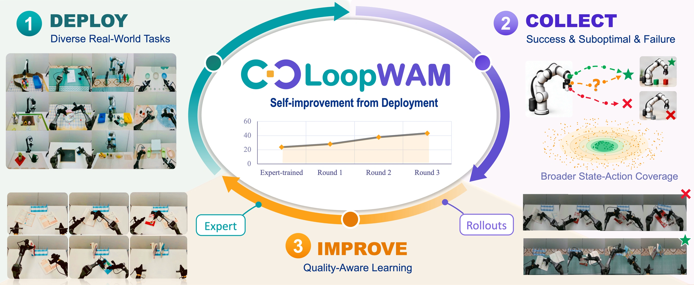
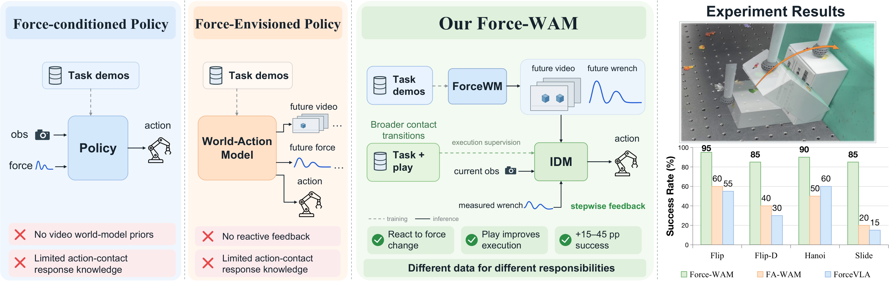
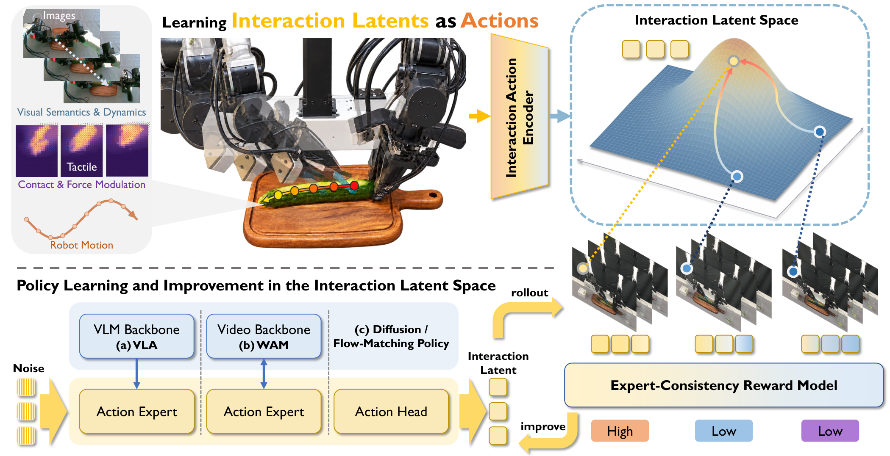
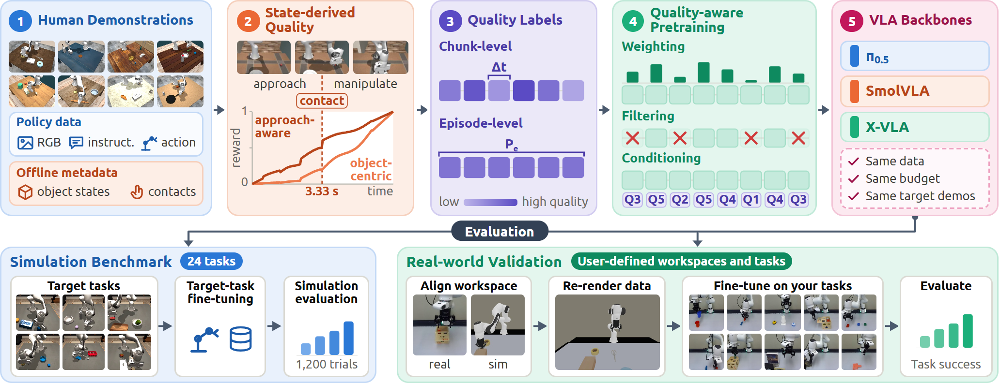

# Daily AI Robotics Briefing — October 14, 2026

## Papers

**LoopWAM: Closed-Loop Generalist Policy Improvement from Deployment Rollouts**

A closed-loop world-action model that learns from the full quality spectrum of real deployment rollouts—successes, failures, and suboptimal behavior—instead of expert demos alone. Three deployment-and-training rounds lifted real-world success from 23.7% to 43.3% on RoboChallenge Table30-V2, with best-overall results on RoboTwin 2.0 (94.5%) and RoboCasa365 (49.5%).

*LoopWAM closed-loop policy improvement*

[arXiv](https://arxiv.org/abs/2610.18873) · [Project page](https://loop-wam.github.io/)

**ForceWAM: Decoupling Future and Response Learning from Demo and Play Data for Contact-Rich Manipulation**

Decouples contact-rich manipulation into two learned pieces: a world model predicting task-compatible visual–wrench futures from demonstrations, and an inverse-dynamics model learning execution from both demos and task-agnostic play. Hits 85–95% mean real-robot success on sliding, box flipping, and ring placement, with play data adding 15–45 percentage points.

*ForceWAM method overview*

[arXiv](https://arxiv.org/abs/2610.18852) · [Project page](https://force-wam.github.io/)

**ILA: Interaction Latents as Actions for Contact-Rich Manipulation**

Encodes the evolution of motion, contact, and force into shared “interaction latents” used as policy action targets—post-training pretrained VLAs and world-action models—and supports offline improvement via expert-consistency rewards. Improves success by 21–36.5 points averaged over four real-world contact-rich tasks.

*ILA interaction-latent framework*

[arXiv](https://arxiv.org/abs/2610.18855) · [Project page](https://mrsecant.github.io/ILA/proj_page/)

**What Matters in Quality-Aware VLA Pretraining: A Benchmark and Empirical Study**

Introduces AXIS-Bench to study how demonstration quality should be used in VLA pretraining (weighting vs. filtering vs. conditioning). Finds approach-aware episode conditioning beats plain behavioral cloning, and sim-to-real pretraining lifted real-world success from 9.6% to 31.7%.

*AXIS-Bench study overview*

[arXiv](https://arxiv.org/abs/2610.18869) · [Project page](https://axis-bench.github.io/)

**WorldOracle: Benchmarking Action-Conditioned World Models against Real-World Executions**

A benchmark that checks whether an action-conditioned world model’s predicted rollout actually reproduces what happens on the real robot—physical state correctness, interaction alignment, and multi-view coherence—evaluating seven representative models. Datasets, code, and leaderboard are to be released.

[arXiv](https://arxiv.org/abs/2610.18826)

## Hot Discussions

**Stanford’s OpenWAM, explained**

Tofufo Labs breaks down the world-action model study comparing Video-Then-Action vs. Action-Then-Video vs. joint training: ordering barely mattered, but robot-video pretraining jumped LIBERO-Long from 68.4% to 97.8%. Policy checkpoints not yet released.

[Reel](https://www.instagram.com/reel/DebDy4oh5k6/)

**Odyssey-3: “foundation world model that simulates reality”**

Odyssey’s official research preview film circulated widely, showing dual-arm manipulation, humanoid, and driving applications from a single world model.

[Thread](https://www.threads.com/@t3chbrief/post/DeeoPrMDdH9)

**Apollo humanoid learns cornhole from a single video**

DeepMind demo: Google’s Argon model watched one clip of a person tossing bean bags, mapped the scene, reasoned out the physics, wrote its own simulation to practice, and transferred the behavior to the Apollo robot.

[Reel](https://www.facebook.com/reel/2162146144730400/)

**Westlake WR1: two humanoids, one task**

Two Westlake Robotics humanoids cooperate to fold a pair of pants—bimanual multi-robot cooperation on a deformable object, framed as a world model plus whole-body “general brain.”

[Reel](https://www.instagram.com/reel/Deaob6wABDp/)

## Podcast Updates

**Latent Space — “Dyna-2: General Purpose Physical Agents with Hour-Long Autonomy” (Oct 13)**

Jason Ma of Dyna Robotics discusses Dyna-2, a world-action model pre-trained on a million hours of human video that predicts future video to guide robot actions—scaling laws, diffusion transformers, and real commercial deployments.

[Episode](https://www.latent.space/p/dyna)

This edition covered new VLA and world-action model research, robotics discussions, and podcast updates for October 14, 2026. Images appear only for papers with supplied representative figures.
