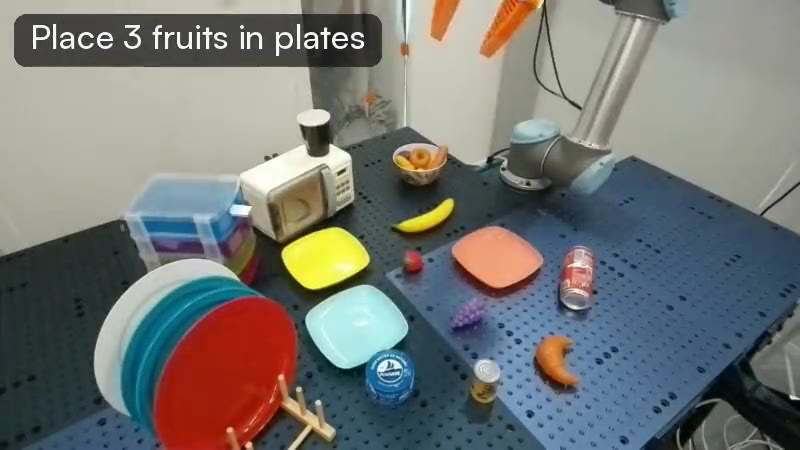
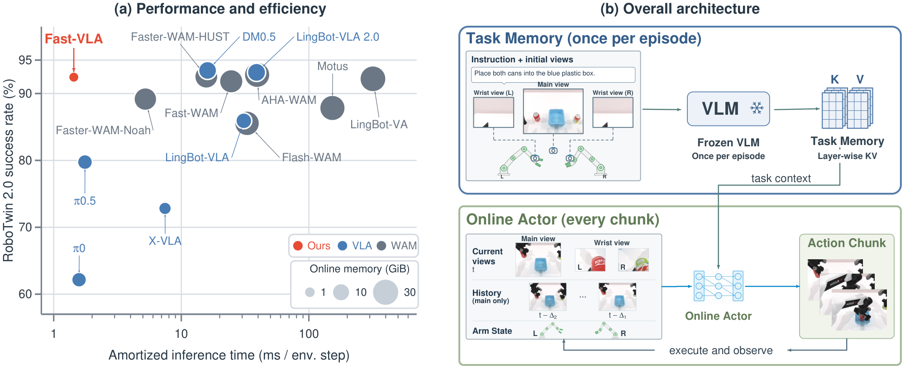

# Daily AI Robotics Briefing — October 16, 2026

## Papers

**REKI: Registering Knowledge in VLAs**

A 2.4B VLA from Kyutai/Inria pretrained on public data only, setting a new performance/size Pareto frontier on LIBERO-Plus, RoboTwin, and RoboCasa. It adds register tokens inside the flow-matching action expert for near-zero-cost recent memory via the KV cache, cutting pose oscillation ~4x in sim and on real robots. Fully open weights plus training, data, and deployment code.

*REKI adds register tokens to the action expert for efficient recent memory.*

[Paper](https://arxiv.org/abs/2610.22178) · [Project page](https://kyutai.org/reki/) · [Code](https://github.com/kyutai-labs/reki)

**Fast-VLA: You Only Think Once for Robot Manipulation**

Calls a frozen 4B VLM exactly once per episode to encode the instruction and initial views into a fixed multi-layer key-value task memory; a lightweight online actor then fuses visual and proprioceptive feedback into action queries that retrieve task context from that memory. 92.46%/92.40% on RoboTwin 2.0 Clean/Randomized, 10.9–17.1x lower amortized inference time, only 1.22 GiB resident VRAM—an engineering path to high-frequency closed-loop VLA control.

*Fast-VLA separates one-time task encoding from high-frequency closed-loop control.*

[Paper](https://arxiv.org/abs/2610.21389) · [Project page](https://garfield-kh.github.io/FastVLA/)

**VeriVLA: Adaptive Test-Time Verification for Flow-Based VLAs with Latent World Models**

Addresses noisy action chunks from flow-based VLA sampling with a training-free dual-axis trigger that detects critical states, then ranks candidate action chunks in latent space using a JEPA-style latent world model—no pixel reconstruction. Real-task completion rises from 50.8% to 65.5% at only +326 ms per trigger on an RTX 4090.

[Paper](https://arxiv.org/abs/2610.21985)

**T2-z: Test-Time Optimization of Environment Latents for Robotic World Models**

Adds learnable environment latents to robot world models; two-stage training lets structured representations of friction, mass, and other factors emerge unsupervised. At test time the world model stays frozen while only the latent is optimized from one or a few real interactions, adapting to unseen configurations. Object prediction error 15.20 → 7.00, action success 33.73% → 72.96% across 7 sim scenes and 4 real tasks. Authors include Li Fei-Fei, Jiajun Wu, Leonidas Guibas, and Yejin Choi.

[Paper](https://arxiv.org/abs/2610.22364)

**VLA-Δ: Learning Physical State Transition for Vision-Language-Action Models**

Argues most VLAs fit observation-action mappings without explicit supervision of intermediate physical state changes, and instead supervises the physical transition between current and future states (~484 hours / 24M frames of multi-level annotations across DROID, MolmoAct, RH20T), with zero inference overhead. 98.4% average on LIBERO, 90.06%/89.74% on RoboTwin 2.0 Clean/Randomized, and beats π0.5 on real robots.

[Paper](https://arxiv.org/abs/2610.21306) · [Project page](https://zju-omniai.github.io/VLA-Delta/) · [Code](https://github.com/ZJU-OmniAI/VLA-Delta)

## Hot Discussions

**StarVLA’s quiet open-source release**

An animated explainer on the low-key open release of StarVLA, a VLA model reaching 95.7% on the LIBERO sim benchmark; notable for the team’s unusually honest flaw documentation (e.g., failing to stack simple blocks), its 62GB/80GB-GPU footprint, and research-only licensing.

[View post](https://www.facebook.com/reel/1492990832933439/)

**AA-Robotics v0.1: frontier LLMs drive a real robot arm**

Artificial Analysis’ new benchmark puts five frontier language models (GPT-6 Astra, GPT-6.1 Sol, Gemini 4 Argon, Claude Opus 5.5, Claude Fable 5.1) in control of a 6-axis robot arm across eight physical tabletop tasks (button pressing, pouring, block tidying, tower building, writing “hello world”). Astra leads (~69 pts) but every model runs ~100x slower and far costlier than a human. Shared by an AI research commentator on Threads.

[View post](https://www.threads.com/@leilasanfordai/post/DegXFsmCL85)

**CHORUS: one VLA policy for decentralized multi-robot teams**

A single shared VLA backbone (π0.5 LoRA) adapted for decentralized multi-embodiment collaboration: each robot runs its own copy on local observations plus a robot-identity prompt, no communication at inference. Beats a centralized VLA upper bound and reaches 90% task success with three-robot teams.

[View post](https://www.instagram.com/reel/DegcmVHgo9k/) · [Project page](https://chorus-anon.github.io)

**RoboJEPA: latent world model for robotics**

A technical breakdown of RoboJEPA, a latent world model pairing a frozen V-JEPA 2.1 visual encoder with a trainable predictor conditioned on robot ID and view, trained across 12 robotic embodiments with prediction accuracy linked to planning performance. Shared by an AI research commentator on Threads.

[View post](https://www.threads.com/@ksenia_turingpost/post/DeeXbpyGyO1)

## Podcast Updates

**Nothing notable today.**

No new robotics, VLA, or world-model episodes from the tracked shows in the last day or two.

This edition covered five papers on efficient VLA memory, test-time verification, environment adaptation, and physical-state supervision, plus four field discussions; no notable podcast releases.
