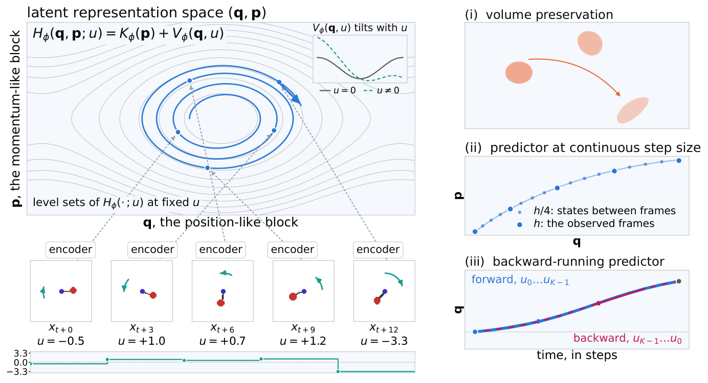

# Daily AI Robotics Briefing — October 18, 2026

## Papers

**Dexterity from Supervised Play (Botao He, Yiming Dou, Yiannis Aloimonos, Jitendra Malik, Akash Sharma, Ruoshi Liu — UC Berkeley)**

A play policy cloned from minutes of human play autonomously collects contact-rich data to train a world model, then plans under it — beating hindsight behavior cloning by 69.6% on a real multifingered hand with 490x less interaction than RL, zero task demos needed.

*A play policy cloned from minutes of teleoperated play collects the data that trains the world model.*

[Paper](https://arxiv.org/abs/2610.22340)

**CoDA: Co-Evolution of Data Engines and Action Policies (Tianjiao Yu et al.)**

A sim data engine and action policy co-evolve via a shared memory of builds, failures, and progress; a VLM critic diagnoses failures and generates targeted hard cases. OOD success jumps 5.3% to 27.6%, and 15 rounds lift LIBERO-Pro success 25% to 84% under perturbations.

*CoDA’s shared memory lets the scene generator and the action policy improve each other.*

[Paper](https://arxiv.org/abs/2610.22362)

**FACT: A Multimodal Force-Action-Track Foundation Model for Human-to-Robot Dexterity (Zhi Cao, Yining Hong, Jiaolong Yang, Yejin Choi, Li Fei-Fei, Jiajun Wu, Huang Huang)**

Pairs the new EgoForce human tactile dataset with a two-stage model: a track-guided coarse planner predicts actions, future video, and visual tracks, then a force-action refiner shapes actions with anticipated force. Up to 60pp over T-Rex on ten force-sensitive tasks.

*FACT pairs a track-guided coarse planner with a force-action refiner.*

[Paper](https://arxiv.org/abs/2610.19155)

**I3L: Iterative Interactive Imitation Learning for Whole-Body Mobile Manipulation (Wensi Ai, Jiajun Wu, Li Fei-Fei, Ruohan Zhang et al.)**

Low-cost open-source JoyLo+ interface (policy-tracking leader arms, touch-triggered takeover) feeds HG-DAgger iterations: +68.3pp autonomous success, at least 90% on every task, takeover time down 72% across four rounds.

*JoyLo+ takeovers feed I3L’s iterative HG-DAgger rounds across three embodiments.*

[Paper](https://arxiv.org/abs/2610.17748) · [Project page](https://i-3l.github.io/)

**LeHami: Symplectic Latent Dynamics for World Models (Romina Yalovetzky, Randall Balestriero, Yann LeCun)**

Symplectic Hamiltonian JEPA with exactly-symplectic leapfrog integration preserves phase-space volume at every rollout step, ruling out latent contraction — long-horizon velocity prediction beats unconstrained JEPA and supports unseen sub-frame step sizes.

*LeHami’s symplectic integration preserves phase-space volume at every rollout step.*

[Paper](https://arxiv.org/abs/2610.15267)

## Hot Discussions

**NEURA’s Neuron AI — one Perception-Language-Action brain across five embodiments**

NEURA’s Neuron AI launch (Oct 14) is still making the rounds — a Perception-Language-Action model fusing 3D vision, touch, audio, robot state, and language with memory, one brain across five embodiments; the 11-minute autonomous 4NE1 laundry demo at NVIDIA GTC Berlin (Oct 20-22) is the proof test.

[Announcement](https://neura-robotics.com/neura-robotics-introduces-neuron-ai/)

**Kyutai’s REKI — cheap memory for a 2.4B VLA**

Kyutai’s REKI (2.4B VLA with cheap memory) continues to circulate — its 32 cached register tokens add memory for ~0.1 ms per chunk and cut pose oscillations on RoboTwin from 18.6% to 4.1%; weights are open (CC BY-NC-SA).

[Coverage](https://www.marktechpost.com/2026/10/17/meet-kyutai-reki-the-2-4b-vla-model-bringing-efficient-memory-to-robot-manipulation/)

## Podcast Updates

**Researcher’s Guide to Physical AI — Ep 11: “Gemini Argon Comes Third on a Real Arm, Astra Stabs a Doll” (Oct 17)**

Gemini 4 Argon’s robotics pitch vs. a real-arm benchmark (GPT-6 Astra led), the RoboHarm refusal test, NVIDIA AlphaNIST, and video world-model physics failures.

[Episode](https://www.physicalaipodcast.co/episodes/011/)

**Robot Talk — Ep 166: “Evolving robot bodies and brains” (Oct 16)**

Claire Asher talks with Cambridge’s Rika Antonova on co-evolving robot hardware and algorithms, data-efficient RL, and co-design for dexterity.

[Episode](https://www.robottalk.org/2026/10/16/episode-166-rika-antonova/)

This edition covered five papers on dexterity from play, co-evolving data engines, force-aware human-to-robot transfer, interactive imitation for whole-body mobile manipulation, and symplectic world models, plus two field discussions and two podcast episodes. Images appear for every paper, from supplied representative figures.
