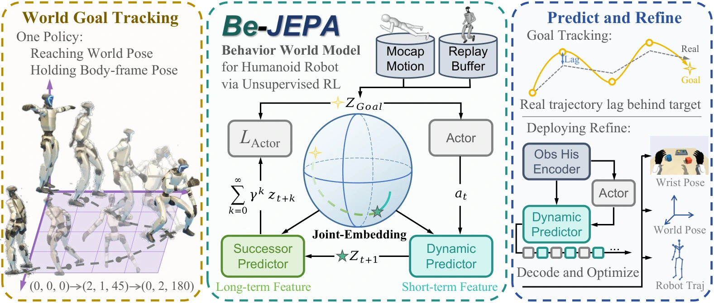

# Daily AI Robotics Briefing — October 19, 2026

Five papers on a large-scale stress-test of GPT-6-Astra as a robot brain, online exploration without teleop data, a JEPA world model for humanoids, Mamba action experts for faster VLAs, and unified language-action-world modeling—plus the REKI coverage wave, the Dyna world-action-model debate, and a podcast conversation on open models for physical AI.

## Papers

**Has GPT-6-Astra Achieved Embodied Intelligence?**

SenseNova’s large-scale stress-test of GPT-6-Astra as a robot brain: unprecedented scores across 12 benchmarks (manipulation, humanoids, mobile, dexterous) under an in-context-learning protocol, plus a costly-but-effective “System 2 (GPT-6-Astra) + System 1 (π0.5)” harness — yet real-world trials on 8 robot configs expose gaps (expensive demos, no trading time for success under physics). Verdict: embodied competence crossed, practical embodied intelligence not yet.

[arXiv](https://arxiv.org/abs/2610.22471)

**RAX: Scaling Online Exploration for Robot Agents**

A coding agent writes robot control code and improves purely through online exploration — no teleop data, no hand-engineered primitives. Multi-embodiment study (single-arm, bimanual, dexterous, mobile, humanoid; sim and real): +37.4% over baselines in sim; real robots learn memory-dependent, articulated, deformable, long-horizon tasks with emergent error recovery. From a heavyweight author bench (Abbeel, Ermon, Torralba, Dawn Song, Yilun Du). A credible path past the demo-data bottleneck.

[arXiv](https://arxiv.org/abs/2610.22496)

**BeJEPA: A Goal-Conditioned Humanoid Behavior World Model via Unsupervised RL**

A JEPA-style world model for humanoids jointly representing posture, world position, and heading; cuts body-position error ~60% vs. baselines and runs on a real Unitree G1 (stand-up recovery, kick robustness, goal tracking).

*BeJEPA’s joint-embedding world model tracks world goals while holding body-frame pose.*

[arXiv](https://arxiv.org/abs/2610.23127) · [Project page](https://ylyem9x.github.io/BeJEPA-project)

**MambaAct: Efficient Mamba Action Experts for Flow-Matching VLAs**

Replaces the π0.5-style Transformer action expert with a compact Mamba expert plus a context compressor: 10× smaller expert, 64.8% lower denoising latency on LIBERO (58.8% real-world), while *improving* LIBERO success ~1 pp. A direct attack on VLA inference latency.

[arXiv](https://arxiv.org/abs/2610.22951) · [Code](https://github.com/giakhuyendihoc/MambaAct)

**LAW: Unifying Language, Action, and World Modeling for Agentic Physical Intelligence**

Closed-loop VLM–world-action-model framework: a hybrid-expert VLM plans subtasks fused with a mixture-of-Transformer-experts video–action world model. 94.21% avg success across 50 RoboTwin tasks (claimed open-source SOTA); 65% vs. 28.3% π0.5 on three real long-horizon tasks. Evidence that language reasoning + world imagination + action generation compose better than any one alone.

[arXiv](https://arxiv.org/abs/2610.23334)

## Hot Discussions

**REKI coverage wave continues (MarkTechPost)**

Public outlet MarkTechPost broke down Kyutai’s REKI — the first open VLA (2.4B) with cheap rolling robot memory (last 3 frames, 32 register tokens, <1% overhead), pretrained only on public data; 90.4% on LIBERO-Plus, pose oscillation cut from 18.6% to 4.1%.

[Threads](https://www.threads.com/@marktechpost/post/DeoHcRaEmFH)

**Weekend debate: Dyna’s pivot from VLA to world-action models**

A Threads post distills co-founder Jason Ma’s claim that lab success (99.4%) collapsing to 75% in commercial deployment (Din Tai Fung) exposes VLA’s teleop-data bottleneck — world-action models (predict video, then act) are the proposed answer. This is the weekend’s central embodied-AI argument.

## Podcast Updates

**Practical AI — “Open models and the future of Physical AI with NVIDIA” (Oct 1)**

Daniel Whitenack interviews NVIDIA Cosmos Lab’s Ming-Yu Liu on open world models and physical AI. Missed in earlier briefings; directly on-topic for the world-model thread.

[Episode](https://share.transistor.fm/s/217445d3)

Note: TWIML’s latest (#780, Oct 15) is about e-commerce ranking, not robotics; Robot Brains has no new episode in the window — no other fresh robotics episodes today.

**Coverage note.** Today’s edition covers five new research papers, two field discussions, and one podcast episode. A representative figure appears with the BeJEPA paper; the other papers have no verified image today.
